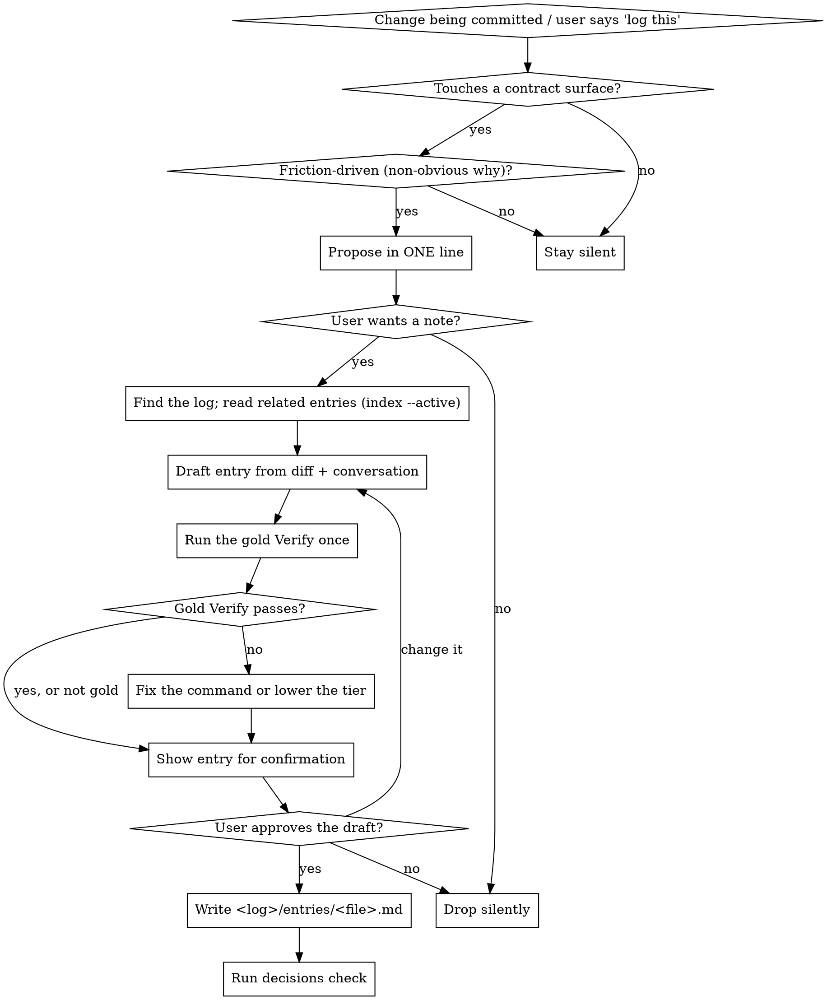

# Decision Log

Capture the *why* of contract-significant, friction-driven changes as small, **verifiable** notes — before the reasoning evaporates into the diff. Each entry is forward-compatible with a future trust-layer / architecture-fact checker that re-runs the `Verify` lines.

This habit must survive deadlines. It optimises for low friction and honest, checkable facts over completeness. Capturing a high-signal *subset* reliably beats capturing everything and rotting (the ADR graveyard).

## Skill Type: Mixed Rigid/Flexible

**Rigid gates (non-negotiable):**

- Propose in ONE line; never write the entry before the user confirms.
- Never nag — if the user declines, drop it silently and continue.
- `Verify` MUST be honestly tiered (gold / partial / unverifiable) — never a vague "looks right".
- Run a gold `Verify` once before writing it down. If it fails, or can't run, fix it or lower its tier.
- Never pick the log's location yourself in a repo that has none: ask (see Where the Log Lives).
- `Anchor` MUST use stable references (symbol names, #issue/PR, commit-pinned permalinks) — NEVER a bare `file:line`.
- Never fabricate the date.

**Flexible path (use judgement):**

- Whether a given diff is genuinely "contract-significant" (when unsure, do NOT propose — false positives train the user to ignore you, which kills the habit).
- How to phrase Friction/Decision concisely.
- Which verification mechanism fits (test, pyeye query, grep, import-linter contract, human review).

## When This Fires

**Primary trigger — the commit checkpoint.** When a commit is being prepared and the staged diff touches a **contract surface**, propose ONE decision note before finalising. Contract surfaces:

- a public/exported signature changed (params, return, raises)
- a documented invariant or guarantee (e.g. "never raises", "pure consumer", "absence ≠ zero")
- a predicate / schema / config contract (a new key, a changed default)
- an edge / API contract (what a tool returns, a discriminated-union branch)
- a non-obvious "why we did it this way" decided in the working conversation

**Secondary trigger — on demand.** The user says "log this decision" (or similar), commit or not.

## Do NOT Trigger When

- Pure bugfix, rename, formatting, dependency bump — no contract change, no non-obvious why.
- A new test case only (not test-infrastructure contracts).
- The change is mechanical and self-explanatory from the diff.
- You are unsure it clears the contract-significant bar — default to silence.

## The Flow (propose → read → draft → confirm → write → check)

The Workflow diagram below is the same flow.

1. **Propose in ONE line.** e.g. *"That `stop_when` change alters a predicate contract — log a decision note?"* Do not draft yet. On decline, drop it.
2. **Find the log and read what exists.** Locate it (Where the Log Lives), run `python -m pyeye.decisions index --active`, and open the one to three entries that matter. The new decision may amend or supersede one.
3. **Draft from the diff + conversation.** Fill every field. Pull the *why* from what was actually said/decided, not a guess. **Run a gold `Verify` once**: a command that has never passed is a guess. If it fails, fix the command or lower the tier (`partial` / `unverifiable`).
4. **Show the drafted entry** for confirmation. On "change it", revise and show it again; on decline, drop it.
5. **Write on confirm** a new entry file in the log's `entries/` directory (see File Convention). If it amends or supersedes an earlier entry, also update that entry's front matter.
6. **Run `python -m pyeye.decisions check`.** It must pass. Where pyeye
   is installed, `check --resolve` also resolves every `Anchor` and
   `Applies-to` reference with pyeye (CI runs it, #1182).

## Entry Schema

```text
## YYYY-MM-DD — <one-line title>
**Friction:** <the frustration that drove the change — what broke / didn't work / was unsafe>
**Decision:** <what was decided and chosen; the rejected alternative if non-obvious>
**Anchor:** <stable refs only — canonical symbol name(s) + #issue/PR or commit-pinned permalink>
**Applies-to:** <required — EVERY site the rule governs, not just the ones this change touched; or how to enumerate them; or `none (<why>)`>
**Verify:** <gold | partial | unverifiable — see below>
```

Keep each field to a line or two. A 6-line entry that gets written beats a 40-line ADR that doesn't.

**Anchor with no issue or PR.** Anchor on what will still exist: the canonical symbol name(s) the decision governs, and the test (by name) that pins it. Once the change is committed, add the commit SHA or a commit-pinned permalink. Never invent an issue number. The file name drops the issue part and `issues` is `[]` (File Convention).

## Applies-to (required)

`Anchor` names what this change *touched*. `Applies-to` names every site the rule *governs*. The gap between the two is where decisions drift: a rule applied only where the friction showed up, while sibling copies keep the old behaviour (#616; the 2026-11-15 duplication audit found #454, #457, #545 and #360 each applied to only some of their sites).

- **Every new entry has one** (#636). Name every site the rule governs, such as "every primitive", "all five walkers", "every edge in `EDGE_RESOLVERS`" or "no `project.search` call anywhere in `src/`". When the rule has one site, name that site.
- **List the sites by stable reference** (symbol names, a registry, a module set), never `file:line`. If they are better found by a query than a list, give the query, e.g. `every function that builds a jedi.Script(code=...)`.
- **Write each handle in full, from its package** (`pkg.mod.Class.method`,
  not `Class.method` or `mod.func`), and each file as a repo path with a
  `/` (`tests/test_x.py`). `check --resolve` resolves those; a short form
  can't be resolved without a guess, so in a repo that sets a gate date it
  fails in new entries.
- **Name the sites the change did NOT touch.** Writing an `Applies-to` broader than `Anchor` is the point. Say plainly which sites still diverge and link their issue, rather than implying full coverage.
- **Opt out explicitly** when the decision governs no code site (a policy or process decision): write `Applies-to: none (<why>)`, e.g. `none (policy decision: release classification)`. A bare `none`, `n/a`, `TBD` or an empty value is rejected. Better still, name the test or script that enforces the policy, if there is one.
- **Old entries are grandfathered.** Entries written before the rule may lack `Applies-to`; don't backfill them just to add it. `check` fails any entry without one unless it is grandfathered: pass each old file with `--grandfathered NAME` (repeatable), or keep the names in a repo wrapper that calls the module. The list only shrinks: when you give an old entry `Applies-to`, delete its name.
- **A list on the following lines counts.** The value runs from the label to the next `**Field:**` line.

**Prefer a Verify that sweeps the `Applies-to` sites over one that samples a single case.** A gold Verify that checks one handle, one primitive or one call site passes while the other sites drift. Prefer one that enumerates the sites, such as a parametrised test over every primitive, an AST scan of `src/` or a loop over a registry. When only a sample is checkable, label it `partial` and name the unswept sites as the residue.

## Honesty Discipline (what makes this more than prose)

The `Verify` line is the bridge to the trust layer. It MUST be one of three honestly-labelled tiers:

- **Gold (mechanically checkable):** a concrete assertion something can run — a test, a pyeye query, a grep, an import-linter contract. Precise enough to execute.
  `Verify: trace(<project handle>, ["callees"], stop_when={scope:"project"}) returns zero nodes with scope=="external".`
  A sweeping gold Verify covers every `Applies-to` site: `Verify: an AST scan of src/pyeye finds no project.search( call.` beats `Verify: inspect("pkg.X") does not call project.search.`
- **Partial:** the checkable portion as a gold assertion, plus the residue explicitly marked unverifiable.
  `Verify: PARTIAL — "module A imports B; B does not import A" via import-linter forbidden contract. "Must not mutate the registry" needs human/AST review.`
- **Unverifiable:** `Verify: unverifiable — <reason>.` Still record the intent; just be honest the checker can't confirm it.

**Environment caveats are part of honesty.** If a `Verify` depends on conditions that can make it lie (a warm semantic index, a built feature, a running service), say so inline — e.g. `[needs warm index]`. A `Verify` that silently fails on a cold index is a false alarm, not a verification.

## File Convention

**One file per decision**, with no committed index, so two PRs never edit the same lines.

**The tooling ships with pyeye** (#1093): `python -m pyeye.decisions index`, `check`
and `migrate`. Run it from the project root. It reads `docs/decisions/` there
unless `--decisions-dir DIR` (before the subcommand) names another log.
Where pyeye was installed as a Claude Code plugin, run it through the plugin's
environment:

```bash
if [ -n "${CLAUDE_PLUGIN_ROOT}" ]; then  # the plugin's environment
  CLAUDE_PLUGIN_ROOT="${CLAUDE_PLUGIN_ROOT}" CLAUDE_PLUGIN_DATA="${CLAUDE_PLUGIN_DATA}" \
    uv run --no-project python "${CLAUDE_PLUGIN_ROOT}/scripts/plugin_runtime.py" \
    python -m pyeye.decisions index --active
else  # pyeye's own repository, where this is a project skill: the checkout's environment
  uv run --project "$(git rev-parse --show-toplevel)" --frozen \
    python -m pyeye.decisions index --active
fi
```

Otherwise, any environment with `pyeye-mcp` installed: `python -m pyeye.decisions …`.
A repo with no log yet gets "no entries", not an error.

### Where the Log Lives

The log is a directory holding `entries/` (`<log>` below).

- **An existing log wins.** Look for one before anything else: `docs/decisions/entries/`, or an `entries/` directory of `YYYY-MM-DD-*.md` files elsewhere (a repo may say where in its contributor docs). Pass a non-default one with `--decisions-dir`.
- **No log yet: ask before creating one.** Don't assume `docs/decisions/`. A repo's `docs/` is often a published site (mkdocs, Sphinx), where a new directory becomes pages. Ask once, offering `docs/decisions/` as the default, and create only the `entries/` directory under the answer.

### Entry Files

- **Before drafting, read what already exists.** Run `python -m pyeye.decisions index --active` (optionally `--symbol <name>` or `--issue <N>`) and open the one to three entries that matter. The new decision may amend or supersede one of them.
- **Name:** `<log>/entries/YYYY-MM-DD-<issue>-<slug>.md`, or `YYYY-MM-DD-<slug>.md` when there's no issue. Use the date the decision was made, the issue it belongs to, and a short lowercase hyphenated slug of the title.
- One file per *distinct* decision (not per commit; one commit may yield zero or one).
- **Front matter**, then the entry. Each front-matter value is a JSON literal on one line:

```text
---
date: "2026-11-15"
title: "One canonical handle resolver (#623)"
issues: [623]
anchors: ["pyeye.resolver.resolve_handle"]
status: "active"
amends: []
supersedes: []
amended_by: []
superseded_by: []
---

## 2026-11-15 — One canonical handle resolver (#623)

**Friction:** …
**Decision:** …
**Anchor:** …
**Applies-to:** …
**Verify:** …
```

- `title` and `date` match the `##` heading exactly.
- `anchors` lists the governed symbols, the same stable references as the `Anchor` and `Applies-to` lines. It is what `index --symbol` searches.
- **Amending or superseding** an earlier decision: list the old file in the new entry's `amends` / `supersedes`, add the new file to the old entry's `amended_by` / `superseded_by`, and set the old entry's `status` to `amended` or `superseded`. That front matter is the only edit ever made to an existing entry; its body stays as written.
- **After writing:** run `python -m pyeye.decisions check`. It must pass. It validates the front matter, the file name, `Applies-to`, and that every amend/supersede link has its reverse.
  `check --resolve` (needs pyeye; CI) also resolves every `Anchor` and
  `Applies-to` reference of the active entries: a stale handle or a missing
  path fails with `entry:line`. A rename means amending the entry that names
  it, never rewriting its body.
- **No `DECISIONS.md` is needed.** The tooling reads only `entries/`; don't create one. Where a repo already has one, it is a static header, never edited per decision. If it still holds old entries, `python -m pyeye.decisions migrate` splits them into files.

## Workflow



## Date

Take the date from the environment (the session's current date, or `date +%F` / `git log`). NEVER fabricate it.

## Failure Mode

This skill has NO hard tool dependency. If a chosen `Verify` mechanism is unavailable (pyeye down, no import-linter, etc.):

1. Pick a different mechanism that IS available (grep, a test, human review), or
2. Drop the `Verify` to a lower tier and label it honestly (`partial` / `unverifiable — <reason>`).

Never invent a passing check. An honest `unverifiable` is correct; a fabricated gold assertion is a lie that will mislead the future checker.

## Red Flags — You're About to Violate This Skill

- Drafting the entry before the user confirmed.
- Proposing on a pure bugfix / rename / format / dep-bump.
- Writing `Verify: looks correct` or any assertion nothing can run.
- Writing a gold `Verify` you never ran.
- Creating `docs/decisions/` (or a `DECISIONS.md`) in a repo that has no log, without asking.
- Using a bare `file:line` as the `Anchor` or in `Applies-to`.
- Writing a single-case gold `Verify` for a rule that governs several sites, without labelling the unswept sites as residue.
- Proposing a second time after the user already declined.
- Inventing a date or a passing check.

**If you catch yourself doing any of these: STOP.**
