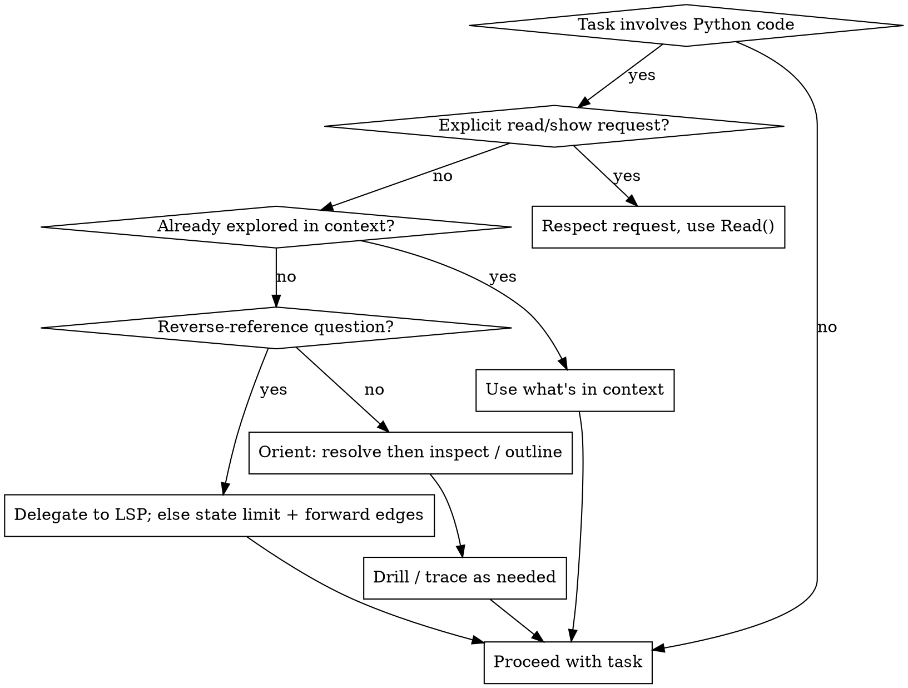

# Python Explore

Build a structural model of Python code with pyeye before reading or changing it —
**orient cheap, drill on demand.**

## The Model: Progressive Disclosure

pyeye answers questions in three widening steps. Start at the cheapest that answers
your question; only go wider when you need to.

1. **Orient (cheap):** `resolve` a name to a canonical handle, then `inspect` it for
   structure, or `outline` a module/class for its skeleton.
2. **Drill (on demand):** `expand` one edge from a handle to see its immediate
   neighbours (members, callees, importers, subclasses…).
3. **Trace (across hops):** `trace` follows edges multiple hops to see structure
   across a call chain, import closure, or member tree.

**Canonical handles are the currency.** A handle is Python's own dotted notation —
`a.b.c.Name` — anchored at the *definition site*, stable across edits, and the same
no matter which import alias you arrived through. Everything downstream takes a handle.
pyeye returns **pointers and structured facts, never source** — when you need the actual
code, `Read` the `file:line` it points you at.

## Skill Type: Mixed Rigid/Flexible

**Rigid gates (non-negotiable):**

- Your first move on unfamiliar Python is pyeye, not a blind `Read()`.
- Never re-explore what pyeye already surfaced in this conversation.

**Flexible (use judgement):**

- How deep to go (a single `inspect`, or a multi-hop `trace`).
- Which primitives and edges to call.
- Whether to write out a mental-model summary — do it when it helps the user, not as
  ceremony (see [Stating Your Mental Model](#stating-your-mental-model)).

## Do NOT Trigger When

- User says "show me", "print", "display", "read this file" — respect explicit requests,
  use `Read()`.
- User says "run", "execute" — that is not exploration.
- User asks "what's the syntax for" — a language question, not a codebase question.
- Single-line typo/string fix where the user gives the exact location.
- Adding a new test case only (not modifying the code under test).
- pyeye output for this symbol is already visible in conversation context — skip straight
  to using it.

## The Primitives

| Primitive | Use it to | Returns |
|-----------|-----------|---------|
| `resolve(identifier)` | Turn a name, dotted path, or `file:line` into a canonical handle | `{handle, kind, scope, location}` — or `{ambiguous, candidates}` |
| `resolve_at(file, line, column)` | Turn a position (stack frame, pasted line) into a handle | same shape as `resolve` |
| `inspect(handle)` | Answer "what is this?" — kind, signature, docstring, `edge_counts` | a structural Node, plus kind-dependent fields (e.g. `superclasses`; `re_exports` is deprecated, use the `re_exports` edge); no source |
| `outline(handle)` | See the structural skeleton of a module or class in one call | a tree of member stubs (direct members by default; `max_depth` to go deeper) |
| `expand(handle, edge)` | Walk ONE edge to the immediate neighbours | a list of stubs |
| `trace(start, follow, …)` | Walk edges across multiple hops | a subgraph (nodes + edges) |

Notes that matter:

- **`kind`** is one of `class`, `function`, `method`, `module`, `variable`, `attribute`,
  `property`, `enum_member`. A name bound in a class body is `attribute` (module- and
  function-level names are `variable`); a member of an `enum.Enum` subclass is
  `enum_member`. Where pyeye can't tell statically that a binding is a member, it says
  `attribute`, never `enum_member`.
- `resolve` already includes a `location` pointer, so it answers "where is this defined?"
  on its own — you do **not** need a follow-up `inspect` just for location. Use `inspect`
  when you want signature/docstring/`edge_counts`.
- **Ambiguity:** a bare name can match several symbols. `resolve` then returns
  `{found: true, ambiguous: true, candidates: [...]}`, each candidate carrying
  `handle`/`kind`/`scope`/`location`. Pick the right one, or re-resolve with the full
  dotted handle. At most 50 candidates come back by default (`max_candidates`); when
  more matched, the result also says `truncated: true`, `truncation_reasons:
  ["max_candidates"]` and `total`. Resolve a dotted handle, or pass
  `max_candidates=None`, to see them all.
- **Capped lists:** `expand` returns at most 200 stubs by default (`max_stubs`). When
  the edge has more, the result says `truncated: true`, `truncation_reasons:
  ["max_stubs"]` and `total` (the edge's full size); pass `max_stubs=None` for all.
  When nothing was cut, none of the three is present.
- **A bare name that is a top-level module resolves to that module.** `resolve("functools")`
  is stdlib `functools` and `resolve("inspect")` is stdlib `inspect`, even when the project
  also defines something with that name. To reach the project's symbol or submodule, use
  its dotted handle: `resolve("jaraco.functools")`, or `pyeye.mcp.operations.inspect` in
  pyeye's own repo. Only two top-level packages sharing a name across project roots stay
  ambiguous.
- **A bare method or class-attribute name is a fallback.** Bare names are looked up
  among modules and top-level definitions first; only if none match does `resolve` look
  at methods and class-body attributes. One match → that member (`resolve("load_settings")`
  → `pkg.config.Loader.load_settings`); several → `ambiguous` with every candidate. Because
  it's a fallback, a top-level `helper` answers `resolve("helper")` and a same-named
  `Class.helper` is **not** listed. Use `Class.helper`'s dotted handle for it. Dunder names
  (`__eq__`, `__repr__`) are never matched this way; they return `unresolved` with a hint
  to use the class's dotted handle or `expand(<class>, "members")`.
- **Not found:** check `found` on every `resolve`/`resolve_at`/`inspect`/`outline`/`expand`
  result. A miss returns `{found: false, <your input echoed>, reason, detail}` with **no**
  node, tree, or stubs, and `detail` naming the next step:
  - `inspect`/`outline`/`expand` echo `handle` (plus `edge` for `expand`), with
    `reason: "unresolved"`. That means "pyeye couldn't resolve this handle as written":
    unknown, **not** evidence the symbol is absent, and not an empty symbol. Often it is
    the right name under the wrong module path, but some real symbols never resolve (an
    instance attribute assigned in `__init__`, such as `self.project_path = …`).
    Re-`resolve` the bare name to get the canonical handle; if that misses too, fall
    back to `Read` or your LSP before concluding anything.
  - `resolve` echoes `identifier`, and `resolve_at` echoes `file`/`line`/`column`. Their
    `reason` is `unresolved`, `file_not_found` or `no_symbol_at_position`. A missing file
    is not a spelling problem, so don't retry `resolve` with other names for it.
  - Only a `handle` key is ever a handle. Never pass `identifier` or `file` to `inspect`.

  By contrast, `expand`'s `stubs: []` with `found: true` *is* a measured zero.
- **Errors vs misses:** a call that ran is always a response (found, `found: false`, or
  unsupported). A miss is never an error. A call fails with an **MCP tool error** only
  when it can't run: an invalid argument (e.g. `line=0`), a `project_path` that doesn't
  exist, an unusable config, or an unreadable file. The error message names what to
  fix, so fix that argument and call again; don't read a tool error as "not found".
- **Unparseable source:** if a file can't be parsed by the Python pyeye runs on (e.g.
  the code uses newer syntax), its edges weren't measured. `expand` / `trace` say
  `reason: "unparseable"` and `outline` marks the node `truncation_reason: "unparseable"`
  with no `children`; `inspect` leaves the count out. That is unknown, not empty: `Read`
  the file (the `detail` names the line), or run pyeye on a newer Python.
- **`scope`** is `"project"` or `"external"`. Project symbols get full-graph answers;
  external symbols (stdlib, site-packages) get project-scoped answers — see the scope
  example below.
- **No source content, ever.** `inspect`/`outline`/`expand`/`trace` return pointers and
  structured facts. `Read` is the content layer.

## Supported Edges

`expand` and `trace` walk these edges. This is the **complete** set pyeye can answer
reliably today:

<!-- fact:begin edges.implemented -->
`members`, `callees`, `imported_by`, `subclasses`, `superclasses`, `imports`, `enclosing_scope`, `submodules`, `re_exports`
<!-- fact:end -->

| Edge | Direction | Meaning |
|------|-----------|---------|
| `members` | container → children | a class's methods/attributes, or a module's top-level defs (imported names belong to `imports`, not here) |
| `submodules` | package → child modules/subpackages | a package's direct child modules and subpackages (one hop; full tree via `trace`) |
| `enclosing_scope` | child → parent | the one lexical scope containing this symbol (method → class, etc.) |
| `callees` | function → what it calls | forward call targets resolved from the body |
| `subclasses` | class → its direct subclasses | project classes that **directly** extend this class (one hop; full closure via `trace`) |
| `superclasses` | class → its bases | the class's direct base classes, in declaration order; bases that don't resolve are listed in `unresolved_superclasses` |
| `imports` | module → what it imports | every import that binds a module-scope name — including ones under `if TYPE_CHECKING:` or a `try`/`except ImportError` shim (both branches); imports inside a `def`/`class` body are not module imports |
| `imported_by` | module → its importers | project modules that import this module, wherever the import sits (inside a `def`/`class` body too: a lazy import is still a dependency) |
| `re_exports` | symbol → the public modules that re-export it | each stub is the re-exporting **module**; its `bindings` lists the public paths it provides (`["pkg.Foo"]`). Public = a package `__init__`, a name in `__all__`, or a public module importing from a `_private` one. Not counted in `edge_counts`; unparseable package files are listed in `unparseable_files` |

**`imports` and `imported_by` are not exact inverses.** If `imports(M)` shows
module `B`, then `M` is in `imported_by(B)`. The reverse can fail: a module that
imports `B` only inside a function shows up in `imported_by(B)` but not in its
own `imports`, and `imports` reports a re-exported name at its definition site,
not the module it was imported from.

**Pointer-only stubs.** `subclasses` and `imported_by` stubs are *pointers*
(handle + location + kind) and intentionally omit `signature` — even though a
subclass stub's kind is `class`. Drill with `inspect(<handle>)` when you need a
subclass's constructor signature or docstring.

**Static-surface ceiling.** Each structural edge measures a stated scope, and a
returned list is complete only over that scope. A class's `members` (and so its
`outline`) are its **class-body definitions**: methods, nested classes and
class-level assignments. Instance attributes assigned in methods (`self.x = …`)
are **not measured**, so `self.project_path` set in `__init__` is absent from
`members` although it is in source. A module's `members` are its module-level
definitions. None of these edges covers what exists only at runtime: `members` / `outline` /
`subclasses` do not see runtime-injected relationships — metaclass injection,
`setattr`, `__getattr__`, `type(...)`, `__init_subclass__` registration, or
`importlib` with computed targets. So `outline` of a Django `Model` omits its
metaclass-injected `_meta` / `objects` / `DoesNotExist`, and the `subclasses`
edge (direct children) plus a `trace` subclass closure cover literal
`class B(A):` subclassing only. An absent member or subclass means "not
measured in that scope": unknown beyond it, **not** proof of absence. Don't
report a static result as exhaustive over instance attributes or the runtime.
(Same boundary `imported_by` already names for dynamic imports.)

The boundary is also in the response (#417): `expand` carries `ceiling`, the root
of `outline` carries `ceiling`, and `trace` carries `ceilings: {edge: id}`. The ids:

<!-- markdownlint-disable MD050 -- dunder names are quoted verbatim from edges.CEILING_MEANINGS -->

- `static_definitions`: definitions written in source: a class body (methods, nested classes, class-level assignments) or a module's top level. Instance attributes assigned in methods (self.x = ...) and anything injected at runtime (metaclass, setattr, __getattr__, type(), __init_subclass__) are not included.
- `literal_subclassing`: project classes whose class statement names this class as a base; classes built with type(), class factories or __init_subclass__ registration are not included.
- `declared_bases`: the bases written in the class statement; bases added at runtime are not included, and bases that don't resolve are listed in unresolved_superclasses.
- `static_imports`: import statements written in source; importlib / __import__ with a computed name is not included.
- `static_calls`: calls whose target static analysis resolves; dynamic calls are counted in unresolved_call_sites, not listed.
- `on_disk_modules`: modules and subpackages present on disk under the package; entries added to __path__ at runtime are not included.
- `package_reexports`: import bindings written in source in the public modules of the symbol's own package (#712); re-exports from other packages and names provided lazily by a module __getattr__ are not included.

<!-- markdownlint-enable MD050 -->

`enclosing_scope` has none: lexical nesting is exact.

## ⭐ Honest Limits — pyeye Has No Reverse References (Delegate to Your LSP)

This is the most important rule in this skill.

**"Who calls this?" and "what references this?" cannot be answered by pyeye** — delegate
them to your LSP (below). The
edges `callers`, `references`, `read_by`, `written_by`, `passed_by`, `overrides`,
`overridden_by`, `decorated_by`, and `decorates` are **deferred** — they need an indexed
reference backend (Pyright) that isn't wired up yet ([#333](https://github.com/okeefeco/pyeye-mcp/issues/333)).
When you ask for one, pyeye **refuses** (reports it as unsupported) rather than returning
a wrong or empty answer. Likewise, `inspect`'s `edge_counts` simply **omits** `callers`
and `references` — it does not report them as `0`.

**Do NOT fake reverse-reference data.** Delegating to a real reference backend (your
editor's LSP — see below) is *not* faking; this is the cheat to avoid:

- Do **not** fall back to `grep` to guess who calls or references a symbol.

> **There is no legacy escape hatch.** Earlier versions shipped three tools that v2.0
> removed: `find_references`, `get_call_hierarchy` and `analyze_dependencies` were
> **removed in v2.0**, not deprecated, because they answered confidently and wrongly:
>
> - the removed `get_call_hierarchy` returned a structurally always-empty `callees`
>   list, and it anchored bare names on the first match with no ambiguity signal;
> - the removed `analyze_dependencies` classified every first-party module as
>   third-party on a `src/` layout, which silently disabled its own cycle detection;
> - the removed `find_references` claimed "ALL usages" with no way to tell an empty
>   result from a failed search.
>
> If you remember them, they are gone — a confident wrong answer is worse than an
> honest "not available."

Why the line falls here: pyeye answers structural facts from the AST, semantic questions
with bounded Jedi inference, and leaves the reverse queries Jedi gets wrong to a
deterministic backend. The contract behind that split, and how a name becomes a canonical
handle, is in [Resolution and Determinism](https://github.com/okeefeco/pyeye-mcp/blob/main/docs/architecture/resolution.md).

### The reliable path: delegate to your LSP

A real reference index is almost certainly already in your toolbox — a language-server
(LSP) tool backed by Pyright/Pylance (e.g. Claude Code's `LSP` tool). Use it. pyeye and
the LSP **compose**: pyeye hands you the definition-site `location` (`file:line:column`)
from `resolve` / `inspect` / `resolve_at` — exactly the position an LSP reference query
needs.

Pipeline for "who calls / references this?":

1. `resolve(name)` → canonical handle + `location {file, line_start, column_start}`.
2. Feed that position to the LSP: `findReferences`, `incomingCalls` (callers), or
   `goToImplementation`.
3. The LSP answers in positions; `resolve_at(file, line, column)` maps any of them back
   into pyeye handle space when you want to keep working there.

**Roles, not redundancy.** pyeye *drives* orientation, structure, and forward facts; the
LSP is the *reference specialist* you delegate the inbound questions to. Do **not** run
them as two interchangeable navigators, or consult both for the *same* fact — they infer
independently (Jedi vs Pyright) and can disagree, and two oracles voting erodes the trust
a single honest answer is for.

### When no LSP is available

If your harness has no language-server tool, **say so plainly**: "pyeye can't give
reliable caller/reference data (deferred to #333), and there's no LSP here to delegate
to." Then offer what you *can* answer — and still do **not** substitute grep:

- **Forward** from a function: `callees` (what it calls).
- **Around a module:** `imported_by` (who imports it) and `imports` (what it imports).
- **Inheritance:** `subclasses` / `superclasses`.
- **Structure:** `members`, `enclosing_scope`.

### Hit a pyeye bug or limitation? Report it in-band

pyeye tells you where to file. Every `unsupported` result from `expand`, and any
`trace` that names an unsupported edge, carries a `report_issues` URL. The
`pyeye://about` resource returns pyeye's version + repository + issues URL on
demand — fetch it instead of guessing the repo slug. If a limitation looks like a
real defect (not an expected static-surface ceiling), surface that URL to the user.

### Absence vs zero

The general rule: **a value pyeye returns is a measured claim over a stated scope;
anything it doesn't return, or can't resolve, is unknown, not absent.** That covers
`found: false` (a resolution miss, not proof of absence), returned lists
(complete only over their stated scope, see the static-surface ceiling above), and
optional fields (absent means not measured).

When you read `edge_counts`, a **missing key means "not measured," not "zero."** A
present `superclasses: 0` means measured-and-none (the class has no bases). An *absent*
`callers` key means pyeye didn't measure it — don't read that as "no callers."

### `trace` honesty fields — an empty subgraph is not always "nothing there"

A `trace` Subgraph carries several honesty fields. **Read them before treating the graph as
complete** — an empty or clean-looking subgraph can mean a resolution miss, not a real zero:

- **`unresolved_roots`** (always present): `[]` means every root resolved. A **non-empty**
  list means those start handles did *not* resolve — so `nodes: {}` with a non-empty
  `unresolved_roots` is "I couldn't resolve the root" (a cold-start miss is possible, #419),
  **not** "this root has no neighbours." Retry, `resolve`/`inspect` the handle, or fall back
  to `Read`/your LSP — do not conclude the symbol calls/contains nothing.
- **`unresolved_nodes`** (always present): interior nodes `trace` reached but could not
  resolve (the same handles `expand` answers `found: false` for),
  so it did **not** walk them. A node listed here is a dead end of the walk, **not** a
  node with no neighbours.
- **`unsupported_edges`** also lists an edge that doesn't apply to some node's kind
  (e.g. `imports` on a class), with `reason: "not_applicable"`: its `detail` names the
  kind and the kinds the edge does apply to. Those nodes were not walked along that
  edge — that's "not applicable", not "measured, none". `expand` gives the same
  `not_applicable` answer directly (e.g. `members` on a function, `subclasses` on a
  module), never a `stubs: []`.
- **`unresolved_call_sites`** (present only when you traced `callees`): a `{handle: count}`
  map of nodes whose outbound calls were *not* fully resolved (dynamic/un-inferable sites,
  or a flaky miss). A node listed here has **incomplete callees** — don't treat its part of
  the call graph as exhaustive. An absent field means call sites weren't measured (you
  didn't trace `callees`); `{}` means traced and all resolved.
- **`unresolved_imports`** (present only when you traced `imports`): a `{handle: [target, …]}`
  map of nodes whose `imports` walk couldn't resolve a statically-present `from X import Y`
  (each entry is the intended dotted target). A node listed here has an **incomplete import
  set** — a dependency closure is missing those edges. `expand(handle, "imports")` carries
  the same signal as a flat `unresolved_imports: [target, …]` list (`[]` when all resolved).
- **`unresolved_importers`** (present only when you traced `imported_by`): a
  `{handle: [file, …]}` map of files that import that module but have **no module name**
  (a path part that isn't a Python identifier, e.g. `my-script.py`, `tools-dir/x.py`), so
  they can't be stubs. They are still dependents: count them when sizing fan-in.
  `expand(handle, "imported_by")` carries the same flat `unresolved_importers: [file, …]`
  list (`[]` when every importer has a handle).
- **`unparseable_files`** (present only when you traced `subclasses`, `imported_by` or `re_exports`): a
  `{handle: [file, …]}` map of project files the server's Python **couldn't parse** (often
  newer syntax than its interpreter), so the reverse scan never read them. A subclass or
  importer defined there is **unknown, not absent**. `expand(handle, "subclasses" |
  "imported_by" | "re_exports")` carries the same flat `unparseable_files: [file, …]` list (`[]` when every
  file parsed). Read those files, or run pyeye on a newer Python, before concluding.

So "no callers"-style reasoning from a `trace` result requires `unresolved_roots == []` **and**
(for call graphs) the relevant node absent from `unresolved_call_sites`; a dependency-closure
claim from `imports` likewise requires the node absent from `unresolved_imports`, and a
"nothing depends on this" claim from `imported_by` requires it absent from `unresolved_importers`
— and, for `imported_by` and `subclasses`, an empty `unparseable_files`.

### Framework plugin tools — always pass `envelope=true`

When pyeye detects Pydantic, Django or Flask (in the project or a configured package),
it also registers that framework's tools (`find_pydantic_models`, `get_model_schema`,
`find_django_models`, `find_flask_routes`, `find_error_handlers`, …). After
`configure_packages` adds a package that brings a new framework, its result lists the
newly activated plugins in `activated_plugins`, and their tools are **callable by name
at once**: call them even if your tool list hasn't refreshed (pyeye sends no
list-changed notification). By default they return a bare list:
an empty answer is *zero content items*, and nothing says which scope was searched.
"These are all the models" looks the same as "these are the main repo's models".

**Another project:** pass `project_path`, as on the core tools. Plugin tools run against
the given project even if its framework wasn't auto-detected there; an empty result means
the scan found none. Omitted, they answer about the project the server started in. A
`project_path` that doesn't exist is a tool error.

**Always call them with `envelope=true`.** You get one object back:

```text
{ scope: "main", searched: ["main"], unsearched_scopes: ["namespace:company"], results: [...] }
```

- **`results`** is the tool's normal answer (`[]` means searched and found none).
- **`searched`** lists the configured scopes that were fully searched.
- **`unsearched_scopes`** lists configured scopes the search did **not** cover. If it is
  non-empty, don't call the result complete: retry with `scope="all"`, or say which
  scopes you didn't search.

These tools read source as text and only skip files that can't be read or parsed. A
tool *error* means the search failed. Report it; don't treat it as an empty result.

Each result record carries a `handle` when it names a symbol: pass that to `inspect`,
`outline`, `expand` or `trace`, rather than re-resolving the record's `name`, which can
be ambiguous. A record with `unresolved` instead has no handle; say so rather than
guessing one.

## Workflow



## Worked Examples

Handles below use a placeholder project (`myapp.…`) — substitute your own. The
`pathlib` example is real and works anywhere.

**"What is `Settings`?"** — orient in one or two calls:

```text
resolve("myapp.config.Settings")   -> { handle: "myapp.config.Settings", kind: "class",
                                        scope: "project", location: {...} }
inspect("myapp.config.Settings")   -> kind, signature, docstring,
                                        edge_counts: { members: 7, superclasses: 1 }
```

**Ambiguous name** — let `resolve` disambiguate, don't guess:

```text
resolve("Settings")  -> { ambiguous: true, candidates: [
                            { handle: "myapp.config.Settings", ... },
                            { handle: "myapp.cli.Settings", ... } ] }
```

Pick the candidate you meant, or re-resolve with the full dotted handle.

**"I'm looking at this line / stack frame — what is it?"** — position to handle:

```text
resolve_at("myapp/cache.py", line=42, column=8)  -> { handle: "myapp.cache.Cache.evict", ... }
```

**"What's inside this module?"** — skeleton in one call:

```text
outline("myapp.cache")        -> direct members (Cache, DependencyTracker, ...); classes marked truncated: max_depth
outline("myapp.cache.Cache")  -> drill into one class: its methods and attributes
outline("myapp.cache", max_depth=2)  -> module + each class's members in one call
```

`outline` defaults to **direct members only** (`max_depth=1`) for every root.
A nested container that has members comes back `truncated: max_depth` with no
`children`, plus `member_count` saying how many it holds. That means "not walked
yet", not "empty": `outline` its handle to drill in, or pass a larger `max_depth`
(`None` = unbounded, still capped by `max_nodes`).

Check the root's `truncation_reasons` first: it lists every reason any node was
cut for (absent when nothing was). `max_depth` / `max_nodes` are budget cuts, so
raise the limit, and the node's count says how much is missing. `external` /
`survey_leaf` are boundaries by design, so outline that node instead.

**Cold start: "what's in this package / project?"** — orient top-down, drill on
demand. `outline` on a *package* surveys its child modules/subpackages (depth-1
by default — subpackages marked `truncated: max_depth`); pass a higher
`max_depth`, or `expand`/`trace` the `submodules` edge, to go deeper. A survey
lists modules, not their members: a module that has members comes back
`truncated: survey_leaf` (`outline` that module to see them), and only a
genuinely empty one is `children: []`. A package's own `__init__` members are
not listed either — `member_count: N` on a walked package says how many were left
out (`expand(pkg, "members")` lists them). Counts are named for their edge and
match `inspect`'s `edge_counts`: a survey cut by `max_nodes` carries
`submodule_count`. A package with no submodules is outlined
by its members instead:

```text
resolve("myapp")                  -> { handle: "myapp", kind: "module", scope: "project" }
outline("myapp")                  -> direct submodules/subpackages (depth-1 survey)
expand("myapp.db", "submodules")  -> one hop of a subpackage's children
trace("myapp", follow=["submodules"], max_depth=3)  -> bounded package tree (capped + `truncated`)
```

Then drill: `resolve(root) → outline(pkg) | expand(pkg, "submodules") → pick a
module → inspect / expand("members") / trace`.

> **Namespace-rooted packages work the same way.** A PEP 420 namespace package
> (no `__init__.py` at its root) resolves to `kind: "module"`, anchored on its
> directory, and namespaces configured in `.pyeye.json` count as `scope:
> "project"`, including repos that live outside the project root.

**"What does this function call?"** — forward, reliable:

```text
expand("myapp.cache.Cache.evict", edge="callees")  -> stubs for each call target
```

**"Who imports this module?"** — reverse, but reliably static:

```text
expand("myapp.cache", edge="imported_by")  -> module stubs that import myapp.cache
```

**"What subclasses this base?"** — inheritance down. `expand` returns the
**direct** children (one hop); for the full transitive closure use `trace` with
explicit bounds (the class result carries a static `transitive_hint` pointing
there):

```text
expand("myapp.plugins.Base", edge="subclasses")  -> project classes DIRECTLY extending Base
trace("myapp.plugins.Base", follow=["subclasses"], max_depth=3)
  -> bounded subtree of the full subclass closure (capped + `truncated`)
```

**Multi-hop closure** — structure across hops:

```text
trace(start="myapp.cache.Cache.evict", follow=["callees"], max_depth=3)
  -> subgraph of the 3-hop forward call structure
```

**Project vs external scope** — `pathlib.Path` is external, so subclasses come back
project-scoped:

```text
inspect("pathlib.Path")                      -> scope: "external", members/signature derived on demand
expand("pathlib.Path", edge="subclasses")    -> only classes in THIS project that extend Path
```

**"Who calls `Cache.evict`?"** — pyeye defers it; delegate to the LSP:

```text
resolve("myapp.cache.Cache.evict")   -> location: { file: "myapp/cache.py", line_start: 42, column_start: 8 }
# then hand that position to your LSP tool:
LSP.incomingCalls("myapp/cache.py", line=42, character=9)  -> real callers, with call sites
```

> pyeye doesn't index callers (deferred to #333), so I delegated: `resolve` gave the
> def-site location and the LSP's `incomingCalls` returned the real callers. (I can map
> any back to a handle with `resolve_at`.)

With **no** LSP tool in reach, the honest refusal instead:

> Reliable caller data isn't available — `callers` is deferred (#333), there's no LSP
> here to delegate to, and grep would under-report. What I *can* show: what
> `Cache.evict` itself calls (`callees`), and which modules import `myapp.cache`
> (`imported_by`). Want either?

## Dependency & Coupling Analysis

Module relationships are answerable from two static edges — `imports` (what a
module depends on) and `imported_by` (which project modules depend on it) — plus
`trace(follow=["imports"])` for the multi-hop closure. From those you can compute
the standard coupling metrics by hand:

- **Fan-out (efferent):** size of `expand(mod, "imports")` — how many things this
  module depends on. High fan-out = many reasons to change = fragile.
- **Fan-in (afferent):** size of `expand(mod, "imported_by")` — how many project
  modules depend on this one. High fan-in = changes here are risky.
- **Instability:** `fan_out / (fan_in + fan_out)`. `0` = stable (depended on,
  depends on nothing); `1` = unstable (depends on others, nothing depends on it).
  Entry points sit near 1; core/shared modules near 0.

**Detecting cycles:** `trace(start=mod, follow=["imports"])`, then scan the
returned `edges` for one whose `to` is the start module. `trace` visits each node
once but still records edges back into already-visited nodes, so that back-edge is
exactly an `A → … → A` circular dependency. (Look in `edges`, not `nodes` — nodes
are deduped, so the start won't literally reappear.) Standard ways out: extract a
shared base module both can import, inject the dependency instead of importing it,
or move the import inside the function (lazy import).

**Reading the architecture:** a clean layered design shows imports flowing one
direction (API → services → models → external) with no back-edges; a "utility
hub" shows one low-instability module with high fan-in; a cycle is the
anti-pattern. Map a few key modules with `expand(…, "imports")` to see which
shape you have before refactoring.

> Same static-surface ceiling as everywhere else: dynamic imports
> (`importlib.import_module()`, plugin loaders, conditional imports) are invisible
> here — an absent edge means "not imported in source," not "never loaded."

## Stating Your Mental Model

When it helps the user — a non-trivial change, an ambiguous request, a risky edit —
state what you found before proceeding. Use **canonical handles + `file:line`** so the
user can correct you:

```markdown
**Mental model: `myapp.cache.Cache`** (`myapp/cache.py:31`)
- Depends on: `myapp.config.Settings`, `collections.OrderedDict`
- I can see: 7 members, 1 superclass (measured); subclasses on demand via `expand`
- Callers/references: pyeye defers them (#333) — get them from the LSP; without one, caller impact is unverified
```

Scale this to the task. A pure "how does X work?" answer may need no separate summary;
a refactor that touches shared code deserves one — and should be explicit that
caller impact can't be statically confirmed.

## Failure Mode

If pyeye is unavailable (server down, tools not responding):

1. Note it explicitly: "pyeye unavailable — falling back to `Read()`."
2. Proceed with `Read()`.
3. Warn that static structural analysis is unavailable.

Don't block — degrade gracefully, but make the limitation visible.

## Red Flags — You're About to Violate This Skill

- Your first tool call is `Read()` on a Python file you haven't oriented in pyeye.
- Reaching for `grep` to find a definition.
- Reaching for `grep` to answer a relationship/reference question.
- Reaching for a pre-v2.0 tool name you remember — the primitives in the table above
  are the whole surface, plus the framework plugin tools when a framework is detected.
- Calling a framework plugin tool without `envelope=true`, or reporting its `results`
  as complete while `unsearched_scopes` is non-empty.
- **Faking "who calls this" with grep** instead of delegating to your LSP (or, with
  no LSP, stating the limit honestly).
- Re-exploring a symbol pyeye already surfaced in this conversation.

**If you catch yourself doing any of these: STOP. Orient with pyeye, or say honestly
what it can't answer.**
